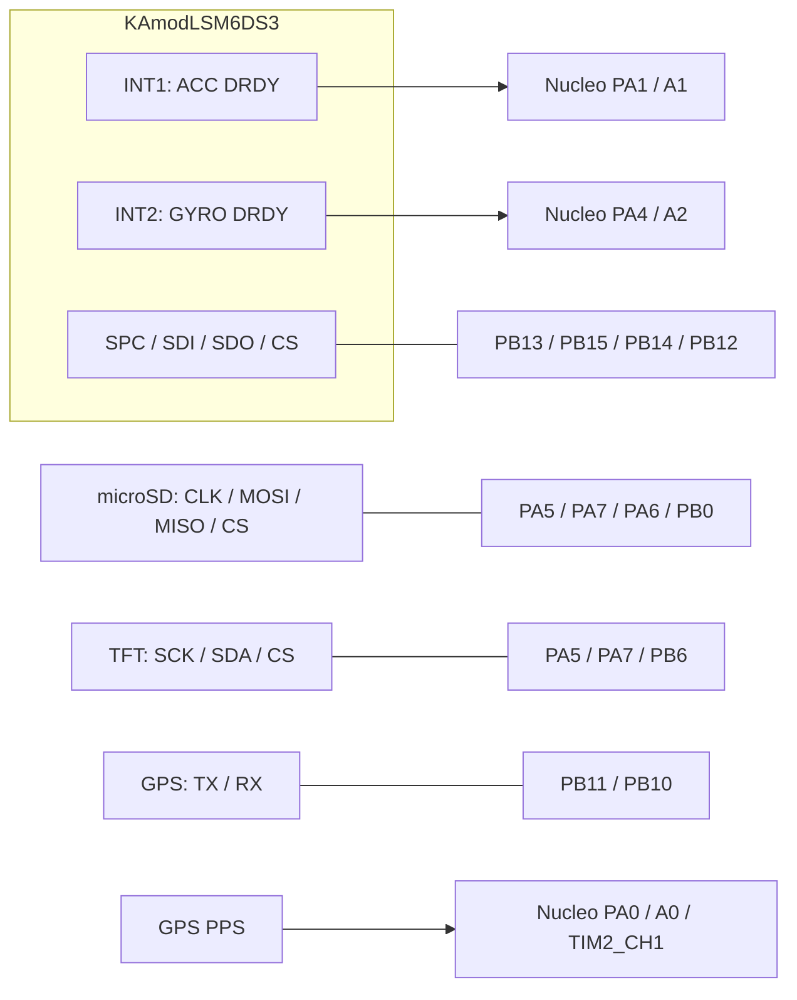

> **2.1.7:** aktualna wersja tylko odczytuje ustawienia do [GPS_CFG.TXT](GPS_CONFIG_QUERY.md). Nie uruchamia procedury przywracania ani resetu opisanej w historii poniżej.

> **Aktualizacja 2.1.6:** GPS wrócił do odbioru NMEA 9600 baud / domyślnie 1 Hz. Konfiguracja 5 Hz, epoki UBX i PPS opisane poniżej są historyczne i nie działają w tej wersji. Aktualny przebieg i ograniczenia: [GPS_RESTORE.md](GPS_RESTORE.md).

# Kontrakt loggera 2.1.0 (P0 + mapowanie PPS)

**Aktualne zmiany 2.1.5:** [Jednorazowe przywrócenie GPS](GPS_RESTORE.md). Zmiany 2.1.4: [GPS bez automatycznych restartów i IMU bez SD](GPS_DIAGNOSTICS.md). [Mapowanie PPS](GPS_PPS.md). Historyczny przegląd P0: [P0_REVIEW_2026-11-02.md](P0_REVIEW_2026-11-02.md).

P0 wprowadza niezależny czas IMU, rzeczywiste zdarzenia DRDY, spójne epoki
UBX, osobne sesje uruchomień i diagnostykę braków. Zachowuje **104 Hz,
±16 g, ±2000°/s**, GPS 5 Hz oraz układ TFT. PPS na PA0 jest przechwytywane sprzętowo jako odniesienie skali czasu.
Czas pomiaru GNSS jest mapowany na MCU przez PPS + TIM-TP. Parametry czasowe poniżej są ustawieniami
oprogramowania; nie są pomiarem dokładności gotowego urządzenia.

## Wymagane połączenia

Dodaj oba przewody zaakceptowane dla P0:

| KAmodLSM6DS3 | Nucleo-F103RB | Funkcja |
| --- | --- | --- |
| INT1 | **PA1 / A1 / CN8 pin 2** | ACC DRDY, zbocze narastające |
| INT2 | **PA4 / A2 / CN8 pin 3** | GYRO DRDY, zbocze narastające |



Wspólna masa, sygnały 3,3 V. Pozostałe połączenia:
[IMU](IMU_LSM6DS3.md), [TFT](TFT_ST7735S.md), [GPS](GPS_NEO6M.md),
[SD](SD_LOGGING.md). TIM2 jest zarezerwowany dla czasu; nie używaj go do
innego PWM/timera. **PA0 / A0 / CN8 pin 1 jest wejściem PPS (TIM2_CH1)**.

## Znaczniki i akwizycja

TIM2 pracuje z nominalnym krokiem 1 µs. W STM32F103RB licznik TIM2 ma
**16 bitów**, więc przerwanie przepełnienia rozszerza go programowo do
64 bitów co 65,536 ms. Odczyt obsługuje przepełnienie oczekujące na ISR.
Zegar startuje raz; nie jest zerowany przez SD, GPS, zmianę UTC ani nowy plik.
HSI/PLL nie jest wzorcem PPS: rozdzielczość 1 µs nie oznacza dokładności 1 µs
ani braku dryfu. Wielokrotne przepełnienie podczas zablokowanych przerwań
przez ponad 65 ms nie jest odtwarzalne; w akwizycji nie ma takiej sekcji.
Dziennik flash uruchomienia jest aktualizowany przed startem tego zegara.

Oba ISR DRDY przejmują osobne czasy, następnie 17-bajtowy SPI2 TxRx DMA
pobiera STATUS, temperaturę i wektory (temperatura nie jest jeszcze logowana).
BDU oraz IF_INC są włączone, FIFO wyłączone. STATUS wymaga XLDA i GDA.
Dla wspólnego wiersza `T_IMU_US = max(T_ACC_US, T_GYRO_US)`.
Jeśli rozbieżność przekracza **500 µs**, wektory w TXT są puste i występuje
flaga PAIR; osobne czasy zostają diagnostycznie. Aplikacja nie może traktować
pustych wektorów jako poprawnego sześciosiowego pomiaru. Przy stałych błędach
PAIR należy zmierzyć fazę DRDY; nie podnosić limitu w ciemno.

Timestamp oznacza wejście do ISR DRDY, a nie środek fizycznego pomiaru ani
chwilę odczytu SPI. Opóźnienie torów filtracji i stały offset względem
fizycznego ruchu nie są jeszcze zmierzone. P0 nie deklaruje spełnienia p99
≤100 µs ani fizycznego przesunięcia torów ≤0,5 ms na podstawie samego kodu.
Filtry pozostają w konfiguracji resetu i zapisanych rejestrów; nie wykonujemy
decymacji. Dump 0x0A–0x19 obejmuje także CTRL6/7/8, potrzebne do analizy torów.

Pierwsza para po uzbrojeniu jest celowo odrzucana, ponieważ zastany wysoki
poziom DRDY nie ma wiarygodnego czasu zbocza. Numer NR jest już przydzielony,
więc początkowa luka i licznik odrzuceń są oczekiwane. Kolejne NR są
przydzielane przed ewentualnym odrzuceniem z kolejki. Nie wstawiamy duplikatów.
Przy braku par przez 1 s następuje ponowna inicjalizacja bez zerowania NR/czasu.

Pierścień surowy ma 255 użytecznych rekordów, około 2,45 s przy 104 Hz.
Kolejka formatowania ma 16 rekordów. Próbki czekają 700 ms na historyczne przypisanie GPS; ekran korzysta z bieżącej próbki. ISR nie wywołuje FatFs ani printf.
SPI1 obsługuje SD/TFT, SPI2 z DMA1 kanał 4/5 obsługuje IMU niezależnie.
Priorytety: TIM2=0, DRDY=1, DMA/USART3=2, B1=3. Nie jest to nieskończony
bufor — przeciążenie daje liczniki i brakujące NR.

## Format TXT

Pierwsze 13 kolumn zachowuje nazwy, kolejność i jednostki. Nagłówek każdego
pliku ma **36 pól**, separator `;`, kropkę dziesiętną, CRLF i żadnych komentarzy:

```text
NR;DATA;CZAS;ACC_X;ACC_Y;ACC_Z;GYRO_X;GYRO_Y;GYRO_Z;GPS_LAT;GPS_LON;GPS_SPEED_KMH;GPS_ALT_MSL_M;T_IMU_US;GPS_STATE;GPS_FIX_ID;GPS_ITOW_MS;IMU_VALID;IMU_FLAGS;T_ACC_US;T_GYRO_US;IMU_DROPPED;IMU_SPI_ERRORS;IMU_PAIR_ERRORS;GPS_UART_ERRORS;GPS_CHECKSUM_ERRORS;GPS_INCOMPLETE_EPOCHS;GPS_LATE_EPOCHS;SD_QUEUE_DROPPED;SD_MAX_PAUSE_US;IMU_MISSED_DRDY;GPS_RX_OVERFLOWS;GPS_INVALID_FIXES;GPS_T_RX_US;GPS_T_MEAS_US;TIME_SYNC_STATE
```

| Pole | Znaczenie |
| --- | --- |
| NR | uint32, kolejność pozyskiwania; luki ujawniają straty |
| DATA, CZAS | pomocnicze UTC `YYYY-MM-DD`, `HH:MM:SS.mmm`; mogą być puste |
| ACC_X/Y/Z | g z grawitacją; signed raw × 0,000488; 6 miejsc |
| GYRO_X/Y/Z | °/s; signed raw × 0,070; 6 miejsc |
| GPS_LAT/LON | stopnie; signed int32 × 1e-7, 7 miejsc |
| GPS_SPEED_KMH | poziome gSpeed z VELNED × 0,036 km/h; 3 miejsca |
| GPS_ALT_MSL_M | hMSL z POSLLH × 0,001 m, 3 miejsca; dla 2D puste |
| T_IMU_US | uint64, µs, bez konwersji przez float |
| GPS_STATE | N — nowa ważna epoka, R — powtórzenie, I — brak ważnej pozycji |
| GPS_FIX_ID | uint32, identyfikator epoki, stały przy R; przy I zachowany, jeśli odebrana epoka jest znana |
| GPS_ITOW_MS | oryginalny uint32 iTOW, ms tygodnia GPS; przy I zachowany, jeśli odebrana epoka jest znana |
| GPS_T_RX_US | rzeczywisty czas ostatniego odebranego fragmentu epoki; przy znanej epoce zachowany także dla I |
| GPS_T_MEAS_US | czas iTOW przeliczony przez model PPS na MCU; pusty przy stanie 0 |
| TIME_SYNC_STATE | 0 = brak mapowania tej epoki, 1 = powiązanie PPS + TIM-TP; nie jest sprzętową walidacją dokładności |
| IMU_VALID | 1 tylko przy braku wszystkich błędów wiersza |
| IMU_FLAGS | maska bitowa opisana poniżej |
| T_ACC_US, T_GYRO_US | osobne znaczniki zboczy w tej samej skali MCU |

[Syntetyczne TXT i SESSION.json dla aplikacji desktopowej](examples/p0/README.md).

Wartości wyjściowe są formatowane z liczb całkowitych. Wszystkie pola dodatkowe
oprócz GPS_STATE są liczbowe. Do integracji używaj różnic rzeczywistych timestampów; `ΔT_IMU_US / 1e6` jest czasem nominalnym, a korektę skali PPS opisano w [GPS_PPS.md](GPS_PPS.md). Nie używaj stałego 1/104. Brak pomiaru jest pustym polem. ACC pozostaje w osiach czujnika,
bez usuwania grawitacji, normalizacji, obrotu do pojazdu lub autozerowania.
Precyzja zapisu nie stanowi deklaracji dokładności.

Maska IMU_FLAGS: `1=SPI`, `2=brak świeżości / utrata DRDY`, `4=para >500 µs`,
`8=clipping int16 na końcu zakresu ADC`, `16=DMA timeout`. Flagi można łączyć.
Dowolna z nich powoduje sześć pustych pól ACC/GYRO. Endpoint ADC nie jest
pełnym testem nasycenia toru analogowego. Nie zapisujemy sześciu zer po błędzie.

Liczniki są kumulacyjne dla uruchomienia, odczytywane przy formatowaniu:

- IMU_DROPPED — odrzucona pierwsza para, pełny pierścień, nadpisany oczekujący DRDY.
- IMU_MISSED_DRDY — ponowne zbocze tej samej osi przed odczytaniem pary.
- IMU_SPI_ERRORS / IMU_PAIR_ERRORS — błędy transportu / parowania.
- GPS_UART_ERRORS / GPS_CHECKSUM_ERRORS / GPS_RX_OVERFLOWS — niezależne błędy transportu.
- GPS_INCOMPLETE_EPOCHS — deadline lub brak wolnego slotu składania.
- GPS_LATE_EPOCHS — spóźnione/zdublowane fragmenty; to liczba fragmentów, nie unikalnych epok.
- GPS_INVALID_FIXES — opublikowane epoki bez poprawnego rozwiązania.
- SD_QUEUE_DROPPED — rekordy odrzucone przez logger, także podczas B1/braku karty; od 2.1.4 brak dostępnego zapisu ma przyczynę `8=storage_unavailable` w metadanych.
- SD_MAX_PAUSE_US — maksymalny czas wywołania procesu SD (w tym sync/mount/metadata), nie samego programowania flash karty.

Te liczniki opisują różne etapy i nie należy ich bezwarunkowo sumować.
Po pełnym buforze/utracie kabla nie znamy liczby wszystkich fizycznych
pomiarów, których nigdy nie odczytano. Czas i luki pozostają rzeczywiste.

## Epoki i czas GPS

POSLLH + VELNED + SOL są składane według iTOW, z deadline 180 ms.
Poprawna pozycja wymaga POSLLH, SOL, gpsFixOK, weekSet/TOWSet i fixa 2D/3D.
Brak VELNED oznacza pustą prędkość, fix 2D — pustą wysokość.
Publikacja jest jednokrotna; późny fragment nie zmienia cache ani ID.
Nowa identyczna pozycja nadal otrzymuje nowy ID i N. Granica tygodnia nie
resetuje ID. Restart łącza GPS unieważnia cache, lecz nie zeruje numeracji.

Dla epoki z lock GPS wybierany jest najbliższy historyczny wiersz IMU według
GPS_T_MEAS_US, dzięki oczekiwaniu próbek 700 ms w istniejącym buforze.
Historia obejmuje 16 epok. Bez lock wybierana jest ostatnia epoka opublikowana
przed timestampem próbki; GPS_T_MEAS_US pozostaje puste. Jeśli historia nie
obejmuje próbki, zapis jest I. Szczegóły: [GPS_PPS.md](GPS_PPS.md).
Timeout 800 ms pozostawia pozycję, prędkość i wysokość puste; znane ID/iTOW/czas RX
pozostają diagnostycznie. I ma pierwszeństwo nad obecnością tych liczb. IMU i zegar działają dalej.
N/R wyznaczane są względem ostatniego ID przyjętego przez f_write, również przez granice plików.
Po błędzie częściowego zapisu importer powinien dodatkowo deduplikować ID;
FAT nie daje transakcji obejmującej wiersz i awarię zasilania.

GPS_T_RX_US pozostaje czasem końca odbioru, oddzielnym od GPS_T_MEAS_US.
Model PPS wymaga zgodności TIM-TP i ważnego NAV-SOL; bez lock nie usuwa
latencji UART. Nawet z lock pozostają niezmierzone opóźnienia torów IMU/GNSS.
Nie deklarujemy fizycznej dokładności ≤5 ms na podstawie samego kodu.

DATA/CZAS próbki pochodzą z NAV-TIMEUTC i modelu PPS, z milisekundami.
Bez lock są puste; ważność UTC jest ograniczona do okolicy ±3 s kotwicy UTC.
T_IMU_US pozostaje monotonicznym zegarem MCU; GPS nie przestawia timera.

## Sesje i wgrywanie

Folder `S<96-bit MCU UID>-<64-bit boot counter>` mieści SESSION.json i TXT.
Ten sam folder obowiązuje podczas B1, rotacji i ponownego montowania SD.
Zmiana mocowania IMU wymaga resetu i nowego folderu; aplikacji Windows należy
wskazać konkretną sesję. Pliki rosną LOG0001…LOG9999; wyczerpanie numerów
zgłasza pełny zapis. Nie wypełniamy niższych luk po usunięciu starych plików.

Licznik uruchomień ma dwustronicowy dziennik flash z CRC i zatwierdzeniem
na końcu. **Linker przeznacza 126 KB na aplikację; ostatnie 2 KB
(0x0801F800–0x0801FFFF) są zarezerwowane.** Nie kasuj tych stron przy zwykłej
aktualizacji. Pełne kasowanie MCU resetuje licznik; istniejący folder na SD
jest wtedy rozróżniany sufiksem -01…-99. W razie błędu rezerwacji boot ID
uruchomienie jest zatrzymywane, aby nie mieszać sesji.

SESSION.json zawiera wersję, boot ID, konfigurację i jej stan weryfikacji,
dump rejestrów, MON-VER, jednostki, ograniczenia synchronizacji i liczniki.
Jest aktualizowany po konfiguracji, przy rotacji i zatrzymaniu. Wymiana używa
SESSION.new i zachowuje poprzedni SESSION.bak; po zaniku zasilania ten backup
może posłużyć do ręcznego odzyskania metadanych. FAT nie zapewnia atomowej
transakcji wszystkich tych operacji. Importer nie ładuje JSON automatycznie.
Położenie anteny jest `null`, ponieważ nie zostało zmierzone.

Budowanie bez CubeIDE:

```sh
bash tests/run.sh
python3 tools/build_firmware.py Debug
python3 tools/build_firmware.py Release
```

W PATH musi być ARM GCC; alternatywnie ustaw ARM_GCC_PREFIX na pełny prefiks
`/ścieżka/arm-none-eabi-`. Skrypt produkuje ELF/HEX/BIN, mapę, raporty `.su`
i `memory-report.json`. Zarówno ten skrypt, jak i prebuild Debug/Release w
CubeIDE uruchamiają `tools/write_build_info.py`. Wymagane Python (`python`
w PATH CubeIDE) i Git. SHA to dokładne 40 znaków commita; zmiany robocze
mają oddzielną flagę `firmware_dirty`. Nie ma fallbacku `unspecified`.
Po aktualizacji projektu w CubeIDE wykonaj Clean/Build. W archiwum bez .git
należy przywrócić pochodzenie źródeł; build ma zgłosić problem, a nie podawać
fałszywego SHA.

TIM2 oraz DMA są obsługiwane w kodzie użytkownika; .ioc zapisuje nowe piny,
lecz nie generuje tych sterowników. Przy ponownej generacji CubeMX zachowaj
bloki USER CODE, ręczne IRQ i rezerwację flash w linkerze; nie dodawaj drugich
handlerów TIM2/EXTI/DMA. Aktualizacje oprogramowania wykonuj po zatrzymaniu logowania.

## Weryfikacja i odbiór sprzętowy

Testy hosta (16 programów, ASan + UBSan, ostrzeżenia jako błędy) obejmują:
ponad 2 h wirtualnego zegara z każdym przepełnieniem, odcięcie programowania
boot ID na każdym kroku, DMA/parowanie/utratę świeżości/clipping, przepełnienia
kolejek i luki NR, transport UBX i opóźnione parsowanie, N/R/I, niepełne epoki,
2D, granicę tygodnia i UTC, 30 min symulowanego zapisu FatFs, rotację, B1,
pełną kartę, wyjmowanie i zmianę karty. Dane testowe są syntetyczne.

Nie podłączono fizycznej płytki do tej sesji. Do wykonania po wgraniu:

1. Zmierzyć oba DRDY analizatorem: ODR, rozkład odstępu ACC/GYRO i opóźnienie ISR/DMA. Podać p50/p99/max, offset i opóźnienia torów osobno.
2. Zapisać co najmniej 2 h, skontrolować NR/T_IMU_US i granice plików; co najmniej 30 min z ruchem, rotacją i rzeczywistą kartą bez strat nominalnych.
3. Odłączyć GPS na 5/10/20 s, uszkodzić ramkę i wymusić przeciążenie; sprawdzić puste GPS, ciągłość IMU, liczniki i powrót N.
4. Zweryfikować dump rejestrów, MON-VER, znaki osi i jednostki niezależnym testem; odróżnić błąd PAIR od błędu karty.
5. Wczytać folder sesji w aplikacji Windows i potwierdzić użycie T_IMU_US oraz N/R/I; kod importera nie znajduje się w tym repozytorium.

Przechodzące testy programowe nie zastępują tych pomiarów ani walidacji
nawigacji z niezależną referencją.
