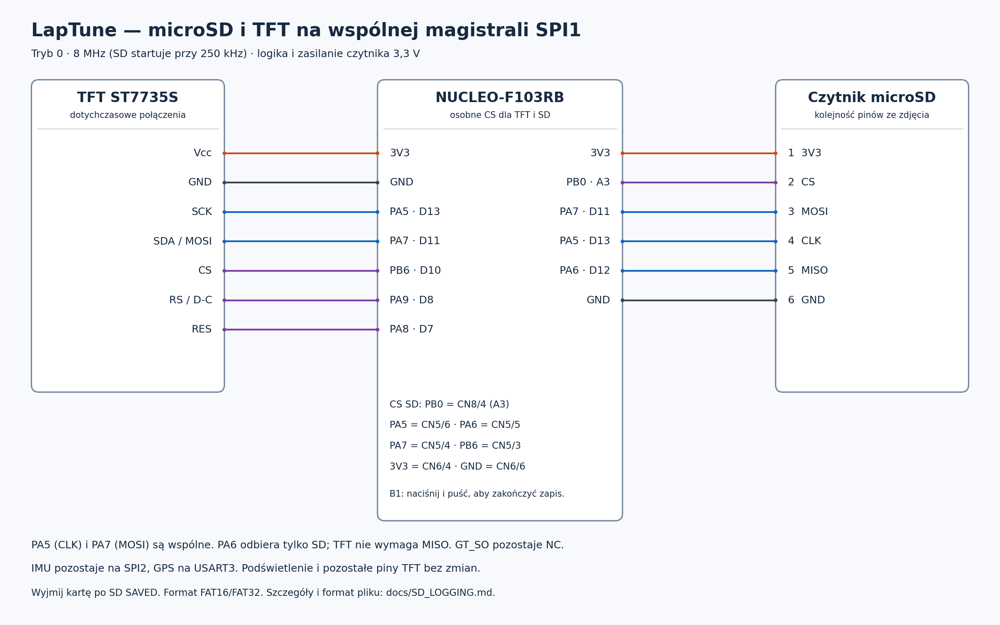

# Zapis pomiarów na microSD

Czytnik ze zdjęcia ma piny **3V3, CS, MOSI, CLK, MISO, GND** i pracuje przy
3,3 V. SD współdzieli **SPI1 z TFT**. IMU pozostaje na osobnym SPI2.



## Podłączenie

| Czytnik SD | NUCLEO-F103RB | Złącze |
| --- | --- | --- |
| 3V3 | 3V3 | CN6/4 |
| CS | PB0 / A3 | CN8/4, także CN7/34 |
| MOSI | PA7 / D11 | CN5/4, wspólne z SDA TFT |
| CLK | PA5 / D13 | CN5/6, wspólne z SCK TFT |
| MISO | PA6 / D12 | CN5/5 |
| GND | GND | np. CN6/6 |

CS wyświetlacza pozostaje na PB6 / D10. TFT nie wymaga MISO; GT_SO pozostaje
niepodłączone. Kod nigdy nie wybiera obu urządzeń jednocześnie. SPI1 pracuje
w trybie 0. TFT nadal pracuje przy 8 MHz, a **SD przy 2 MHz**; inicjalizacja
karty odbywa się przy 250 kHz. Zmiana prędkości odbywa się przy nieaktywnych
CS, a po operacji SD przywracana jest prędkość TFT. Sterownik zwalnia CS SD
i wysyła dodatkowe takty również między poleceniami inicjalizacji.
Nie zmienia się żadne połączenie GPS ani IMU.

Ten czytnik zasilaj **3,3 V**, nie 5 V. Przewody SPI powinny być krótkie.
Przy niestabilnym zasilaniu sprawdź je podczas zapisu; karta może pobierać
większy prąd chwilowy niż wartość średnia z opisu modułu.

## Pliki i format

Karta musi mieć już system plików **FAT16 lub FAT32**, sektor 512 B. Zalecana
karta microSDHC do 32 GB. Karty SDXC są możliwe po przygotowaniu FAT32;
fabryczny exFAT nie jest obsługiwany. Firmware **nie formatuje karty**.
Starsze karty SDSC, w tym **256 MB z FAT16** (w Windows często oznaczone
po prostu jako „FAT”), również są obsługiwane, z adresowaniem bajtowym.

Standardowa odpowiedź starszej SD na CMD8 to `05`. Dla zgłoszonej na sprzęcie
odpowiedzi `00` (oraz `04`) sterownik ponawia pełną sekwencję CMD0/CMD8
maksymalnie trzy razy. Jeśli odpowiedź pozostaje taka sama, próbuje inicjalizacji
starszej SD przez CMD55/ACMD41 bez HCS. Zapis jest dopuszczany dopiero po
poprawnym zakończeniu ACMD41, potwierdzeniu adresowania bajtowego w OCR,
ustawieniu bloku 512 B oraz odczycie CSD v1 z poprawnym CRC i pojemnością.
Odpowiedź `00` sama nie dowodzi, że karta jest starszą SD. Błąd CRC polecenia,
brak odpowiedzi, niepoprawne R7 lub sprzeczne OCR/CSD nadal przerywają start.
MMC nie jest obsługiwane.

Po zakończeniu ACMD41 sterownik czeka do około sekundy na ustawienie bitu
gotowości w OCR, ponawiając CMD58. Nadal wymaga obsługi zakresu napięcia
3,2–3,4 V, zgodności adresowania z rozpoznanym typem SD oraz poprawnego CSD.
Nie akceptuje OCR z samymi jedynkami. Pełna wartość OCR jest zachowywana
do diagnostyki zamiast wyświetlania samej odpowiedzi R1 `00`.

Reset CMD0 jest ponawiany przez maksymalnie około sekundę. Dla starszych kart
odrzucenie CMD59 jako nieobsługiwanego polecenia nie przerywa inicjalizacji.
Sterownik nadal sprawdza CRC16 odczytanych danych i wysyła poprawne CRC przy
zapisie; jeśli karta odrzuci CMD59, sprawdzanie CRC zapisu po stronie karty
pozostaje wyłączone. Potwierdzenie zapisu może być poprzedzone bajtami `0xFF`;
sterownik oczekuje na właściwy token w ograniczonej liczbie taktów.

Zapis rozpoczyna się automatycznie po uruchomieniu. Co **3 minuty** logger
dopisuje bufor do bieżącego pliku, zamyka go i automatycznie otwiera kolejny.
Nie wymaga to naciśnięcia B1. Powstają pliki od `LOG0001.TXT` do `LOG9999.TXT`,
zawsze z pominięciem istniejących nazw, bez nadpisywania wcześniejszych danych.
Po wyczerpaniu miejsca lub dostępnych nazw pojawia się `SD FULL`; logger
okresowo ponawia montowanie, np. po wymianie karty na inną. Sprawdza wolne
klastry przed utworzeniem pliku, więc pełna karta nie otrzymuje nowego pustego
pliku przy każdej próbie.

NR liczy poprawnie odczytane próbki od uruchomienia i **nie zeruje się przy
zmianie pliku, ponownym montowaniu ani wznowieniu przez B1**. Próbki odebrane
w czasie inicjalizacji, braku karty lub ręcznej pauzy także zwiększają licznik,
ale nie trafiają do pliku. Luki w NR pokazują więc przerwę w zapisie;
pierwszy zapisany wiersz może mieć numer większy od 1. Każdy plik ma nagłówek:

```text
NR;DATA;CZAS;ACC_X;ACC_Y;ACC_Z;GYRO_X;GYRO_Y;GYRO_Z
1;2026-10-26;12:34:56.123;0.000488;-1.000000;16.000000;0.070;-70.000;2000.000
```

Pola oddziela średnik, separator dziesiętny to kropka, końce wierszy to CRLF.
ACC jest w g z 6 miejscami po przecinku; GYRO w °/s z 3 miejscami. Precyzja
zapisu jest większa niż na ekranie i nie oznacza takiej dokładności czujnika.
Powtórzone ACC_Y i dwukropek z pierwotnej wiadomości zinterpretowano jako
ACC_Z i średnik, czyli dokładnie 9 kolumn.

DATA i CZAS są w **UTC**. Czas zawiera milisekundy. Bez ważnej, świeżej daty
i godziny z GPS oba pola są puste — pomiary nadal są zapisywane:

```text
2;;;0.000488;-1.000000;16.000000;0.070;-70.000;2000.000
```

Parser zachowuje ułamek sekundy RMC. Między komunikatami UTC jest interpolowany
zegarem STM32. Chwila próbki z kolejki FIFO jest oszacowana według liczby
oczekujących próbek i nominalnej ODR 104 Hz. Nadal nie ma obsługi PPS:
opóźnienie UART/GPS, faza próbkowania i dryf zegarów powodują błąd czasu.
**Trzy cyfry milisekund nie oznaczają dokładności 1 ms względem UTC.**
Kolejna ramka GPS może skorygować interpolowany czas; kolejność rekordów
określa NR. Do ścisłego powiązania próbek z UTC potrzebna jest synchronizacja PPS.
Bez świeżego odniesienia czasu (3 s), dla zbyt starej próbki lub sekundy
przestępnej pola czasu pozostają puste. Nie są zastępowane datą z komputera.

Odstęp między plikami wyznacza zegar STM32, niezależnie od odbioru GPS i korekt
UTC. Trzy minuty są przybliżone: opróżnienie bufora, zamknięcie i otwarcie
pliku wymagają czasu. Próbki napływające podczas przejścia pozostają w kolejce
RAM i trafiają do następnego pliku. Czas liczony jest od otwarcia nowego pliku.

## Odczyt i zapis

LSM6DS3 zapisuje gyro XYZ i accel XYZ do własnego FIFO przy 104 Hz,
bez decymacji. Pętla odczytuje kompletne zestawy. Dzięki FIFO zapis na kartę
nie wymaga zatrzymania czujnika; zniknęło wcześniejsze odpytywanie rejestrów
wyjściowych co 10 ms. Min/max i TFT korzystają z tych samych odczytanych próbek.

Sterownik SD podczas oczekiwania na kartę co kilka ms obsługuje SPI2/FIFO i
parser GPS. Ten callback nie rysuje TFT i nie wywołuje FatFs. Osobna kolejka
RAM mieści 128 rekordów (około 1,2 s przy 104 Hz). Zapis jest grupowany w
buforze 1024 B; `f_sync()` odbywa się co około sekundę. `f_close()` zamyka plik
automatycznie co 3 minuty albo po opcjonalnym zatrzymaniu przez B1.
FatFs i logger pracują tylko w głównej pętli, nie w przerwaniu. Podczas długiego
zapisu rysowanie TFT może chwilowo zwolnić; obsługa IMU/GPS jest kontynuowana.

Czasy można zmienić w `LapTune/Core/Inc/sd_logger.h`:

```c
#define SD_LOG_FILE_DURATION_MS 180000U  /* 3 minuty */
#define SD_LOG_SYNC_INTERVAL_MS 1000U    /* około 1 sekundy */
#define SD_LOG_RETRY_INTERVAL_MS 2000U   /* odstęp między próbami po błędzie */
```

Nie ma gwarancji zapisu przy dowolnie długim zablokowaniu/uszkodzeniu karty.
Przepełnienie FIFO/RAM, utrata wyrównania danych, błąd SPI IMU lub brak próbek
przez sekundę przerywają bieżący plik ze statusem `SD DATA LOSS`. Nowy plik
może zostać otwarty po odstępie ponawiania; po awarii IMU logger czeka także
na powrót poprawnych odczytów. Przy błędzie zapisu ostatni wiersz może być
niepełny. Po odzyskaniu dostępu zapis jest kontynuowany w nowym pliku.

## Ponawianie i wymiana karty

Po błędzie inicjalizacji, odczytu/zapisu lub zapełnieniu karty próba montowania
jest ponawiana **co 2 sekundy od zakończenia poprzedniej próby/obsługi błędu**.
Dotyczy to też startu bez karty oraz wyjęcia karty w trakcie zapisu. Po włożeniu
sprawnej karty FAT16/FAT32 logger automatycznie zakłada nowy plik i wraca do
`SD REC`, bez resetowania Nucleo. Nie formatuje ani nie nadpisuje istniejących
plików. Samo wykrycie błędu i próba inicjalizacji mają własne ograniczone
czasy oczekiwania; nie jest to sprzętowe wykrywanie włożenia w ciągu 2 sekund.
TFT może chwilowo zwolnić podczas próby, a callback nadal obsługuje IMU/GPS.

Po błędzie karty uchwyt pliku i cache FAT są porzucane przed ponownym montowaniem.
Stare rekordy z kolejki nie są odtwarzane na ponownie włożonej karcie: nie
wiadomo, ile bajtów poprzedniej operacji zostało faktycznie zapisanych ani
czy włożono tę samą kartę. Pomiary z okresu niedostępności karty są pomijane;
RAM nie przechowuje całej sesji. NR i liczniki nie są zerowane przy wznowieniu.

Ręczne zatrzymanie przez B1 **wyłącza ponawianie**, aby karta pozostawała
zamknięta do bezpiecznego wyjęcia. Po wymianie karty naciśnij i puść B1
ponownie, aby wznowić zapis w nowym pliku bez resetu. Obsługa B1 odrzuca
powtórne zbocza w ciągu 200 ms i nie wykonuje operacji FatFs w przerwaniu.

## Obsługa na płytce

1. Włóż przygotowaną kartę. Jeśli Nucleo już pracuje, logger podejmie kolejną
   próbę automatycznie, o ile nie został zatrzymany przez B1.
2. Po utworzeniu pliku w stopce pojawi się `SD REC LOGxxxx.TXT`.
3. Co 3 minuty bieżący plik jest zamykany i powstaje kolejny; stopka pokazuje
   jego nową nazwę. Zapis trwa automatycznie przez całą sesję.
4. Jeśli chcesz wyjąć kartę podczas pracy, **naciśnij i puść B1**. Przerwanie
   przycisku tylko zgłasza żądanie; główna pętla dopisuje kolejkę i zamyka plik.
   Wyjmuj kartę po pojawieniu się **`SD SAVED`**. Pomiary i ekran nadal działają.
5. Po zatrzymaniu przez B1 naciśnij i puść go ponownie, aby wznowić zapis.

Zamiast ogólnego `SD ERROR` stopka pokazuje teraz **`SD E…` z przyczyną**.
`SD FULL` oznacza brak miejsca. `SD DATA LOSS` oznacza problem z ciągłością
danych. Te statusy nie oznaczają bezpiecznie zamkniętej, kompletnej sesji.
Bez karty IMU/GPS nadal pracują i wykonywane są kolejne próby montowania.
`PAUSE E…`, `PAUSE FULL` lub `PAUSE LOSS` oznacza ręczne wstrzymanie ponawiania
przez B1 po błędzie; nie potwierdza poprawnego zapisania poprzedniego pliku.

Zapis danych nie wymaga pamiętania o B1: wcześniejsze, 3-minutowe pliki są już
zamknięte, a bieżący plik jest dodatkowo synchronizowany co około sekundę.
Przy prawidłowo działającej karcie i bez uszkodzenia systemu plików nagłe
odłączenie zasilania naraża przede wszystkim dane od ostatniej synchronizacji
oraz próbki pozostające w RAM, zamiast całej sesji.

Nie jest to gwarancja utraty najwyżej jednej sekundy: zanik zasilania podczas
wewnętrznego zapisu karty lub aktualizacji FAT może uszkodzić także system
plików i wcześniejsze dane. Podział na pliki i synchronizacja ograniczają to
ryzyko, lecz pełna ochrona wymaga podtrzymania zasilania wystarczającego do
zakończenia zapisu. B1 pozostaje opcją bezpiecznego wyjęcia karty podczas pracy.

## Diagnostyka błędów

Przykład `SD E03 CMD0 00:FF` zawiera kod FatFs (`03`), etap/błąd sterownika
(`CMD0`), numer ostatniego polecenia w zapisie dziesiętnym (`00`) i odpowiedź
R1 w zapisie szesnastkowym (`FF`). `FF` oznacza brak poprawnej odpowiedzi R1.
Nie identyfikuje sam w sobie konkretnego uszkodzonego przewodu ani przyczyny
elektrycznej. Gdy komunikacja działa, lecz FatFs nie rozpoznaje woluminu,
pokazywane jest np. `SD E13 FAT16/32`, bez dodatkowych pól SPI. Gdy CMD58
zostało przyjęte, lecz kontrola OCR zawiodła, komunikat ma postać
**`SD E03 OCR 00FF8000`**: osiem cyfr oznacza całe cztery bajty rejestru,
a nie numer polecenia i R1. Tę pełną wartość należy zanotować do diagnostyki.

| Przykład / oznaczenie | Znaczenie |
| --- | --- |
| `SD E03 CMD0 00:FF` | Karta nie odpowiedziała poprawnie na reset / wejście w tryb SPI |
| `SD E03 CMD8 08:00` | Nietypowa odpowiedź na rozpoznanie wersji karty przed odczytem FAT; aktualny kod ponawia rozpoznanie i weryfikuje tryb starszej SD |
| `SD E03 ACMD41 41:01` | Karta pozostała w stanie inicjalizacji do upływu limitu czasu |
| `SD E03 OCR 00FF8000` | Przykład OCR bez ustawionego bitu gotowości 31 po upływie limitu |
| `SD E03 OCR 80000000` | Przykład OCR bez deklaracji obsługi napięcia 3,3 V |
| `SD E03 OCR C0FF8000` | Gdy CMD8 nie potwierdziło SD v2: OCR deklaruje sprzeczne adresowanie blokowe |
| `SD E13 FAT16/32` | SPI zainicjalizowane, ale brak rozpoznanego woluminu FAT16/FAT32; możliwy inny format lub uszkodzone struktury |
| `SD E01 CRC 17:00` | Polecenie odczytu przyjęte, lecz suma CRC danych się nie zgadza |
| `SD E01 TOKEN 17:00` | Brak poprawnego tokenu danych po przyjęciu polecenia odczytu |
| `REJECT`, `BUSY`, `STATUS` | Odrzucenie danych, przekroczony czas gotowości lub zgłoszony błąd karty |
| `HAL`, `CLOCK` | Błąd transmisji HAL SPI lub zmiany częstotliwości magistrali |

Po błędzie najlepiej zanotować **całą treść stopki**. Sam napis „FAT” przy
karcie 256 MB nie jest powodem do ponownego formatowania.

W debuggerze: `sd_log_state`, `sd_log_filename`, `sd_log_written`,
`sd_log_error` (FRESULT), `sd_log_dropped` oraz `sd_spi_diag` (przyczyna,
polecenie, odpowiedź R1, token danych/statusu, status HAL i aktywacja CRC karty).
Dodatkowo `cmd8_response`, `cmd8_retries` i `legacy_probe` w `sd_spi_diag`
zachowują wynik rozpoznania CMD8, liczbę ponowień i użycie próby zgodności
dla odpowiedzi `00`/`04`, także po przejściu do dalszych poleceń.
`ocr` i `ocr_valid` zachowują pełny rejestr OCR i informację, czy odczytano
wszystkie cztery bajty bez błędu HAL.
Zachowywany jest pierwszy błąd — późniejszy nieudany `f_close()` go nie zastępuje.
Written liczy wiersze przyjęte
przez `f_write`, nie potwierdzenie trwałości pamięci flash. Dropped zlicza
odrzucone rekordy, próbki odczytane podczas pauzy/braku karty oraz zdarzenia
utraty ciągłości. Nie jest dokładnym licznikiem próbek utraconych w sprzętowym
FIFO ani danych utraconych po wcześniejszym przyjęciu ich przez `f_write`.
Oba liczniki są zachowywane przy automatycznym i ręcznym wznowieniu.

## Biblioteka i testy

FatFs R0.16 jest dołączony do `Core/FatFs` wraz z licencją i identyfikatorem
źródłowego commita ST. Nie trzeba pobierać go przy budowaniu ani zmieniać
ścieżek include w CubeIDE; folder Core jest już objęty kompilacją.
Konfiguracja produkcyjna nie zawiera funkcji formatowania karty.

```sh
bash tests/run.sh
python3 /workspace/.laptune-setup/build.py Debug
python3 /workspace/.laptune-setup/build.py Release
```

Dziewięć programów testowych obejmuje dotychczasowe IMU/GPS/TFT, FIFO,
kalendarz i znaczniki czasu, zapis rzeczywistym FatFs na obrazie FAT w RAM,
format rekordów, ochronę wcześniejszych plików, błędy i pełną kartę,
automatyczny podział co 3 minuty, ciągłość numeracji i kolejki przy zmianie
pliku, B1 podczas przejścia, przepełnienie zegara STM32 i ponowne montowanie
po utracie niesynchronizowanego bufora. Obejmują też protokół SDHC/SDSC,
CRC, osobne CS i timeouty.
Model karty obejmuje również starszą kartę SDSC 256 MB, odrzucenie CMD59,
kilka nieudanych resetów przed poprawną odpowiedzią, oczekiwanie na ACMD41,
opóźniony token potwierdzenia zapisu, CS między poleceniami, prędkości obu
urządzeń i nowe komunikaty diagnostyczne (w tym nierozpoznany wolumin FAT).
Testy CMD8 obejmują stałe odpowiedzi `00`/`04`, pojedyncze `00` przed poprawną
odpowiedzią SD v2, odrzucenie CMD55, sprzeczne OCR/CSD oraz błędne R1 i R7.
Testowane są również opóźniony bit gotowości OCR, jego pełna diagnostyka,
odrzucenie niewłaściwego napięcia i samych jedynek, wielokrotne próby bez
karty, ponowne włożenie tej samej i innej karty, zachowanie plików i luk w NR,
B1 z filtrowaniem zboczy, ręczna pauza ponawiania, pełna karta bez tworzenia
pustych plików, powrót IMU po awarii oraz odstęp ponawiania przy zawinięciu zegara.
Testy programowe nie potwierdzają elektryki modułu ani działania fizycznej karty.
