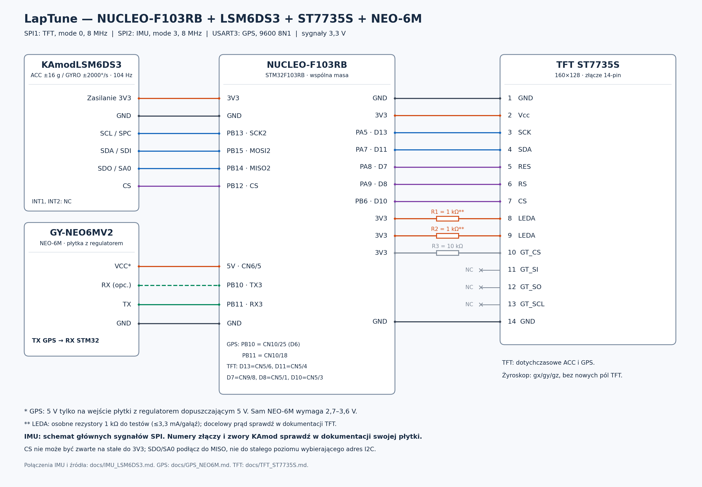

# NUCLEO-F103RB + LSM6DS3 + ST7735S 160×128 + GPS NEO-6M



[Schemat wektorowy SVG](wiring_st7735s.svg).

Dodano GPS NEO-6M na USART3 (PB10/PB11). Pełne połączenia, wymagania zasilania
i opis odczytów: [GPS_NEO6M.md](GPS_NEO6M.md).

Wyświetlacz pracuje poziomo, na osobnym SPI1, w trybie 0, 8 MHz.
LSM6DS3 zastępuje LIS3DH na SPI2, w trybie 3, 8 MHz. Połączenia nowego modułu
i odczyt żyroskopu opisuje [IMU_LSM6DS3.md](IMU_LSM6DS3.md). Wszystkie masy są wspólne.
Sygnały i VCC wyświetlacza: **3,3 V**, bez podawania 5 V na piny.

## Połączenia TFT — kolejność pinów podana przez użytkownika

| Pin TFT | Oznaczenie | Połączenie z Nucleo | Funkcja |
| --- | --- | --- | --- |
| 1 | GND | GND, np. CN6/6 | Masa |
| 2 | Vcc | 3V3, CN6/4 | Zasilanie logiki |
| 3 | SCK | PA5, D13, CN5/6 | SPI1 SCK |
| 4 | SDA | PA7, D11, CN5/4 | SPI1 MOSI, dane SPI, nie I²C |
| 5 | RES | PA8, D7, CN9/8 | Reset, aktywny niski |
| 6 | RS | PA9, D8, CN5/1 | D/C: 0 = komenda, 1 = dane |
| 7 | CS | PB6, D10, CN5/3 | Wybór TFT, aktywny niski |
| 8 | LEDA | 3V3 przez osobny R1 = 1 kΩ na początek | Anoda podświetlenia |
| 9 | LEDA | 3V3 przez osobny R2 = 1 kΩ na początek | Druga anoda podświetlenia |
| 10 | GT_CS | 3V3 przez R3 = 10 kΩ | Nieaktywny dodatkowy układ GT |
| 11 | GT_SI | NC | Nie podłączać |
| 12 | GT_SO | NC | Nie podłączać |
| 13 | GT_SCL | NC | Nie podłączać |
| 14 | GND | GND | Masa |

Podświetlenie: użytkownik potwierdził **dwa LEDA**; pin 9 nie jest traktowany
jako LEDK. Każda anoda otrzymuje osobny rezystor. 1 kΩ to zachowawcza wartość
do pierwszego uruchomienia, ograniczająca prąd do najwyżej 3,3 mA na gałąź;
światło może być słabe. Docelowy prąd, rezystancję i wewnętrzne połączenie
katod z GND trzeba sprawdzić w dokumentacji konkretnego modułu, którego symbol
nie został podany. Nie zasilaj LEDA z GPIO ani nie zwieraj ich bezpośrednio z 3V3.
Piny GT zwykle obsługują osobny układ z czcionkami; kod używa własnej czcionki
i nie komunikuje się z nim. GT_CS utrzymujemy w stanie wysokim.

PA6 / SPI1 MISO pozostaje wolny. PA5 jest połączone także z zieloną diodą LD2
na Nucleo; po zmianie pełni funkcję zegara SPI, więc LD2 nie jest diodą statusu.
Jeśli przewody są długie i transmisja jest niestabilna, skróć je lub zwiększ
preskaler SPI1 z 8 do 16 (4 MHz) w `main.c` oraz w konfiguracji `.ioc`.

## IMU LSM6DS3 (zamiast LIS3DH)

| LSM6DS3 | Nucleo | Złącze Morpho |
| --- | --- | --- |
| VCC | 3V3 | np. CN7/16 |
| GND | GND | np. CN7/20 |
| SCL / SPC | PB13 / SPI2 SCK | CN10/30 |
| SDA / SDI | PB15 / SPI2 MOSI | CN10/26 |
| SDO | PB14 / SPI2 MISO | CN10/28 |
| CS | PB12 | CN10/16 |

Na przesłanym pierwotnym obrazku SCL prowadzi do PB15, a SDA do PB13.
Powyższa tabela odpowiada sprzętowemu SPI2 i kodowi projektu: **SCL → PB13,
SDA → PB15**. Jeżeli odczyt działa na płytce, porównaj te oznaczenia ze swoim
rzeczywistym okablowaniem. LSM6DS3 używa tych samych sygnałów SPI2;
sprawdź ich wyprowadzenia na nowej płytce KAmod.

## Kod i zachowanie

- `tft.c` / `tft.h`: inicjalizacja ST7735S, RGB565, prostokąty i tekst 5×7.
  Bufor jednej linii ma 320 bajtów; pełny framebuffer nie jest potrzebny.
- `acc_display.c`: X/Y/Z w g (1 g ≈ 9,80665 m/s²), minima i maksima od startu.
  Litera osi bezpośrednio poprzedza bieżącą wartość. Po prawej, mniejszą
  czcionką, wyświetlane są maksimum u góry i minimum na dole, bez podpisów.
  Min/max inicjalizowane są pierwszym poprawnym pomiarem, a nie zerem.
  LSM6DS3 ma ODR 104 Hz, zakres ±16 g i BDU; przelicznik 0,488 mg/LSB.
  Żyroskop ±2000°/s jest odczytywany do gx/gy/gz, bez nowych pól na TFT.
- `main.c`: odczyt planowany co 10 ms, odświeżanie ekranu co 100 ms.
  Wysyłane jest jedno pole tekstowe na obieg pętli; nie czyścimy całego ekranu
  przy każdym pomiarze. Transmisje HAL są blokujące, więc okres odczytu ma jitter
  i nie stanowi gwarancji pobrania każdej próbki 100 Hz. Do ścisłego próbkowania
  potrzebny byłby osobny mechanizm DRDY/timer/FIFO/DMA.
- Nieudany odczyt SPI nie nadpisuje pomiaru śmieciami. Przy błędzie czujnika
  wartości są zastępowane czerwonymi kreskami; inicjalizacja jest ponawiana co
  sekundę. Błąd transmisji TFT prowadzi do `Error_Handler()`.
  Bez MISO nie da się wykryć, że sam wyświetlacz jest odłączony.
- `.ioc` i inicjalizacja GPIO/MSP obejmują nowe piny i SPI1.

## Pierwsze uruchomienie i wariant panelu

1. Podłącz układ przy wyłączonym zasilaniu według tabeli.
2. Otwórz `LapTune/.project` w STM32CubeIDE, zbuduj Debug lub Release i wgraj
   przez ST-Link. Pliki w `Core/Src` są objęte ścieżką źródeł projektu.
3. Powinien pojawić się nagłówek LAPTUNE oraz trzy wiersze X/Y/Z z MIN/MAX.
   Sprawdź na płasko około 1 g na osi pionowej i około 0 g na dwóch pozostałych;
   znak zależy od orientacji. Obrót płytki powinien zmieniać wartości i ekstrema.
4. Kontroler ST7735S nie wyznacza jednoznacznie adresów widocznego obszaru.
   Domyślne ustawienia odpowiadają używanemu modułowi: w orientacji 160×128
   `TFT_X_OFFSET=0`, `TFT_Y_OFFSET=0`, `TFT_MADCTL=0x60` (MX | MV, kolejność RGB).
   Obraz pozostaje obrócony o 180° względem pierwotnej orientacji projektu.
   Wcześniejsze 0x68 miało ustawiony bit BGR (0x08), przez co czerwony był
   wyświetlany jako niebieski na tym panelu. Usunięcie tego bitu zachowuje
   orientację i standardowe definicje RGB565, w tym `TFT_RED=0xF800`.
   Dla części innych modułów, np. green-tab, potrzebne są przesunięcia 1 i 2.
   Ustawienia są na początku `Core/Inc/tft.h`; można też przekazać je jako `-D`
   w ustawieniach kompilatora **dla wszystkich plików**.
5. Jeśli obraz jest ucięty/przesunięty, dobierz offsety do dokumentacji panelu.
   Jeśli na innym panelu czerwony i niebieski są zamienione, zmień bit BGR,
   np. 0x60 → 0x68, zamiast zmieniać definicje kolorów RGB565.
   Powrót do przeciwnej orientacji poziomej przy RGB: 0x60 → 0xA0.
   Zmiana orientacji może wymagać również
   korekty offsetów. Przy odwróconych kolorach sprawdź `TFT_INVERT_COLORS=1`.
   Nie stosuj jednocześnie wszystkich tych zmian bez sprawdzenia objawu.

Kontrola rogów po zmianie ustawień: tymczasowo po `TFT_Init()` narysuj cztery
kwadraty 4×4 w (0,0), (156,0), (0,124), (156,124), w różnych kolorach, i sprawdź,
czy widać całe kwadraty. Testy hosta sprawdzają arytmetykę okna, ale nie rozpoznają
fizycznego wariantu szkła. Parametry panelu i jasność wymagają sprawdzenia na płytce.

## Weryfikacja w chmurze

Z katalogu głównego repozytorium:

```sh
bash tests/run.sh
```

Sześć programów testowych korzysta z atrap HAL i sanitizerów Address/Undefined:
komendy inicjalizacji, geometria, RGB565 i CS po błędach; układ pól, liczby,
min/max, harmonogram i przepełnienie ticków; konfiguracja i konwersja LSM6DS3
oraz zachowanie po błędzie SPI. Nie zastępują testu na fizycznym wyświetlaczu.
Dodatkowo sprawdzane są parser NMEA, odbiór UART i widok GPS.

W przygotowanym środowisku chmurowym z `/workspace`:

```sh
python3 /workspace/.laptune-setup/build.py Debug
python3 /workspace/.laptune-setup/build.py Release
```

Wyniki: `/workspace/.laptune-setup/build/Debug/` i `Release/`, pliki
`LapTune.elf`, `LapTune.hex`, `LapTune.bin` oraz `LapTune.map`.
